# System Design for Modern Microservices
## Principles, Patterns & Practices

# Session 1: Introduction to Microservices
**09:30-10:30. Understand the problem before choosing the architecture.**

## Slide 01: System Design for Modern Microservices
**Time:** 3 min | **Mode:** Design exercise

**Slide content**
- A bookstore: browse books, place an order, discover another book.
- One evolving system: understand, design, package, deploy.
- What must still work when recommendations fails?

**Visual**
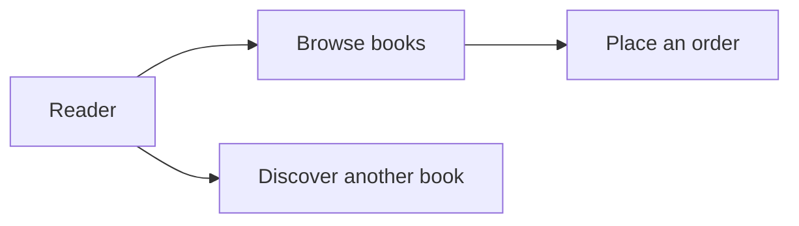

**Speaker notes**
Ask which activity earns the business its revenue and which improves the experience. Let the room disagree before defining essential and optional dependencies. Explain that this lab simulates orders: no money moves. Start Codespaces now while the opening discussion runs; confirm access was checked beforehand. Do not wait until the first command to discover unavailable accounts.

**Lab connection**
Begin Lab 0 setup. Student output: one sentence describing a feature that can be unavailable without blocking an order.

---

## Slide 02: What Are We Designing?
**Time:** 4 min | **Mode:** Design exercise

**Slide content**
- HLD: responsibilities, interfaces, data, scaling, and failure.
- LLD: validation, types, functions, and local implementation.
- A design is a justified set of decisions, not a list of products.

**Visual**
```text
Requirements -> Workload -> APIs/data -> Simple design
             -> Bottleneck -> Failure response -> Trade-offs
```

**Speaker notes**
Use a bookstore example: HLD decides who owns an order; LLD decides how a handler validates a book ID. We will move between both, but deployment commands do not replace design reasoning. Ask "What problem would adding Kafka solve?" Accept "none yet" as a good answer. Requirements can send us back to revise an earlier decision; this is not a rigid waterfall.

**Lab connection**
Pairs classify "choose an order owner" and "reject malformed JSON" as HLD or LLD decisions.

---

## Slide 03: Make Requirements Testable
**Time:** 5 min | **Mode:** Design exercise

**Slide content**
- Functional: browse catalog, submit order, show recommendations.
- Proposed targets: catalog p95 under 300 ms; optional calls bounded.
- Proposed invariant: one checkout intent must not become two orders.
- Explicit non-goals today: real payment, durable data, authenticated users.

**Visual**
| Requirement | Evidence we would need |
|---|---|
| Optional outage does not block ordering | Failure injection plus an order response |
| Catalog p95 under 300 ms | Timed requests at a stated load |
| No duplicate order per checkout intent | Concurrent retries with a persisted idempotency key |

**Speaker notes**
These are teaching targets, not measured claims about the lab. Define p95 as a latency threshold met by 95% of the measured requests. Separate availability from data durability and correctness: a fast response can still lose an order. Ask what "scalable" means without numbers. Let students choose one measurable target and state its test conditions.

**Lab connection**
Student output: three functional requirements, two non-functional targets, and one excluded feature.

---

## Slide 04: Estimate Before Scaling
**Time:** 5 min | **Mode:** Design exercise

**Slide content**
- Assume 20,000 daily visitors, each making 10 catalog API calls.
- Average: 200,000 / 86,400 = about 2.3 catalog requests/second.
- Assume a 20x peak multiplier: about 46 requests/second.
- Which assumption would you verify first?

**Visual**
```text
20,000 visitors/day x 10 API calls/visitor = 200,000 calls/day
Average over 24 hours: 2.3 calls/s
Assumed peak: 46 calls/s
At 10 KB/response: about 460 KB/s payload at peak
```

**Speaker notes**
Use decimal KB and explain that payload excludes HTTP/TLS overhead and images. Do not confuse visitors, concurrent users, page views, and API calls. The peak multiplier is an assumption, not a universal conversion from daily traffic. For extension discussion, 1,000 orders/day at 1 KB/order is about 365 MB/year of raw records before indexes, replicas, and backups. These small numbers do not justify sharding or microservices by themselves.

**Lab connection**
Pairs change one assumption and recompute the peak. Ask whether team deployment independence, rather than request volume, could justify a split.

---

## Slide 05: Run The Simplest Version
**Time:** 10 min | **Mode:** Implemented lab

**Slide content**
- One process serves catalog, recommendations, and an order API.
- One build and deployment boundary.
- Inspect a response before adding infrastructure.

**Visual**
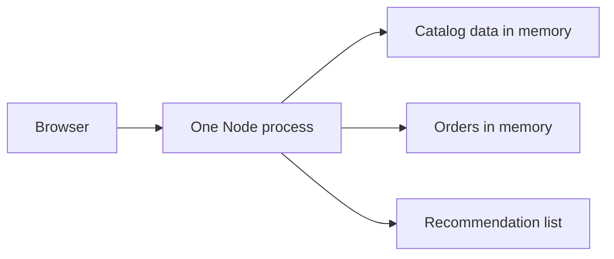

**Speaker notes**
Confirm Lab 0's working directory and versions while pairs open the page through the Ports tab. The monolith page is a display, without a Buy button; its order API is still callable. Its simplicity is an advantage, not something to apologise for. Data is volatile here too. A local function can fail or block; it simply avoids the uncertainty of a remote network call.

**Lab connection**
Lab 1A. Run in one terminal:
```bash
node monolith/server.js
```
Open forwarded port 8080. In a second terminal:
```bash
curl -i http://localhost:8080/api/books
curl -i -X POST http://localhost:8080/api/orders -H 'Content-Type: application/json' -d '{"bookId":1,"title":"The Pragmatic Programmer"}'
```
Expect a catalog response and a 201 simulated-order response. Stop Node with Ctrl+C before Compose needs port 8080.

---

## Slide 06: A Monolith Can Scale
**Time:** 5 min | **Mode:** Conceptual extension

**Slide content**
- Vertical scaling: more resources for one instance.
- Horizontal scaling: more copies behind a load balancer.
- First check state and the real bottleneck.
- More copies do not automatically fix a database bottleneck.

**Visual**
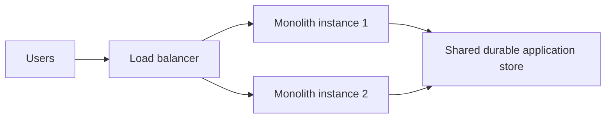

**Speaker notes**
This is not the running lab, whose order array is local to one process. A suitably designed monolith can serve large traffic volumes. The limitation relevant today is separately deploying or scaling one internal capability, not scaling at all. Ask whether doubling application instances helps when the same slow query dominates every request.

**Lab connection**
Student output: identify a state change needed before safely running multiple copies of the current monolith.

---

## Slide 07: Try A Modular Monolith First
**Time:** 4 min | **Mode:** Conceptual extension

**Slide content**
- One deployable; explicit internal interfaces.
- Separate responsibilities without network calls.
- Extract a capability when evidence supports independence.

**Visual**
```text
One deployment
  Catalog module | Order module | Recommendation module
  Explicit interfaces; ownership; dependency rules

Possible later extraction: recommendation module -> recommendation service
```

**Speaker notes**
The starter monolith is intentionally one file, not a finished modular-monolith implementation. Describe modules as an intermediate design students can choose for their own project. Boundaries can improve without adding Kubernetes. Ask what evidence would justify extraction: separate team release cadence, different resource profile, or a useful failure boundary.

**Lab connection**
Pairs choose one module to extract, or defend extracting none. Require a reason other than "it is modern."

---

## Slide 08: Boundaries Follow The Business
**Time:** 5 min | **Mode:** Design exercise

**Slide content**
- A microservice: independently deployable, owns one business capability, owns its data.
- "Small" means small in responsibility, not in line count.
- Catalog owns books; orders owns purchases; recommendations owns suggestions.
- The gateway is an entry-point role, not a fourth business domain.

**Visual**
| Boundary test | Question |
|---|---|
| Responsibility | Can a team explain what it owns? |
| Change | Can it change without coordinated releases? |
| Data | Which service controls writes and invariants? No shared tables. |
| Failure | What remains useful when it is unavailable? |

**Speaker notes**
Four runnable programs are not four equal business capabilities. Splitting controllers from models adds network calls inside the same responsibility. Shared change patterns suggest coupling, but do not mechanically prove a boundary. Mention Conway's Law as an influence of team structure, not a command to make one service per developer. Name "database per service": it means each service owns its data and others cannot reach into it, not that every service needs a different database product or its own machine. Two services writing the same table is the worst option, because they can no longer deploy independently.

**Lab connection**
Use the actual catalog and order folders to identify who owns which in-memory data.

---

## Slide 09: Defend Your Boundaries
**Time:** 10 min | **Mode:** Design exercise

**Slide content**
- College portal: registration, courses, fees, attendance.
- Also results, library lending, hostel rooms, alumni newsletter.
- Propose 3-5 responsibilities and ownership statements.
- What would you keep in one deployment?

**Visual**
```text
Responsibility | Owns | Needs from others | Why separate or together?
______________ | ____ | _________________ | _________________________
```

**Speaker notes**
Use Lab 1B's familiar transfer example without creating a second practical application. Eight activities are listed. Give six minutes for pairs, two for two responses, and two for feedback. Accept fewer deployments than responsibilities; a modular monolith is valid. Ask fee-payment and attendance groups to justify their relationship rather than enforce a reference split.

**Lab connection**
Lab 1B, which the handout now budgets at 11 minutes. Collect a labelled sketch and one defended decision.

---

## Slide 10: Independence Has A Bill
**Time:** 6 min | **Mode:** Conceptual extension

**Slide content**
- Benefits: independent releases, capacity, and team ownership.
- Costs: remote failure, data coordination, deployment, diagnosis.
- Services that must release together and share a database are a **distributed monolith**: the cost of both, the benefit of neither.

**Visual**
| Need | Possible benefit | New responsibility |
|---|---|---|
| Separate catalog capacity | More catalog replicas | Shared/durable state where needed |
| Optional recommendations | Smaller failure scope | Deadlines and fallback policy |
| Independent releases | Less release coordination | API compatibility and automation |

**Speaker notes**
Microservices do not guarantee failure isolation; a long synchronous chain can spread an outage. A distributed monolith is coupled deployment and change behavior, not simply a particular count of repositories. A small team with unknown boundaries may pay these costs without benefiting. Make students name the benefit they are actually buying.

**Lab connection**
Ask: "If all four services need a coordinated release for every feature, what independence did we gain?"

---

## Slide 11: First Checkpoint
**Time:** 3 min | **Mode:** Design exercise

**Slide content**
- Choose the simplest architecture that meets the requirements.
- A monolith can scale; boundaries enable separate decisions.
- Which requirement justified your last added component?

**Visual**
```text
Requirements -> Estimate -> Monolith -> Modules -> Optional extraction
```

**Speaker notes**
Use Quiz 1 questions 2 and 5, then briefly discuss one answer. The full quiz is revision material under this proposed timetable. Transition: independently deployable parts still need to find each other, communicate, and handle uncertainty.

**Lab connection**
Student output: one reason to split and one reason not to split the bookstore.

---

# Session 2: Architectural Patterns
**10:30-11:30. Design communication and failure behavior.**

## Slide 12: One Public Entry Point
**Time:** 3 min | **Mode:** Conceptual extension

**Slide content**
- Gateway: route requests; enforce cross-cutting policy.
- Keep business rules in the owning service.
- Protect and scale the gateway too.

**Visual**
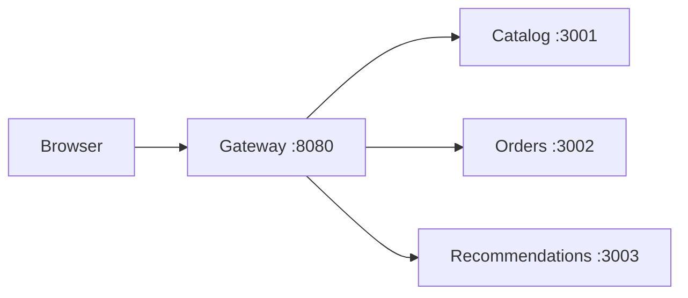

**Speaker notes**
The routing paths are implemented; authentication and rate limits are only possible extensions. No published backend ports does not mean a trusted network or authenticated API. The gateway can be a failure point, so production may run multiple instances. "API Gateway" does not mean all order logic belongs there.

**Lab connection**
Locate the three URLs in [gateway/server.js](../lab-starter/gateway/server.js) and the one published port in Compose.

---

## Slide 13: Find By Name, Route To Instances
**Time:** 3 min | **Mode:** Implemented lab

**Slide content**
- Call `http://catalog:3001`, not a hard-coded instance IP.
- Discovery provides a stable way to locate a service.
- Load balancing selects a serving instance.
- DNS and connections can cache results.

**Visual**
```text
Compose: catalog name -> container address(es)
Kubernetes: catalog name -> Service address -> eligible Pod endpoints
```

**Speaker notes**
Do not claim DNS itself guarantees a different replica on each request. Compose DNS answers, client address selection, connection reuse, and Kubernetes Service routing are distinct mechanisms. The useful observation is that application configuration still calls a name even when instances change. Registry-based discovery is another approach, not another required installation today.

**Lab connection**
Predict what stays unchanged when catalog is replaced or scaled: the gateway's service URL.

---

## Slide 14: Trace A Real Request
**Time:** 8 min | **Mode:** Implemented lab

**Slide content**
- Same catalog, now reached through a gateway and network.
- Four processes; one published port.
- Inspect the JSON and the serving instance.

**Visual**
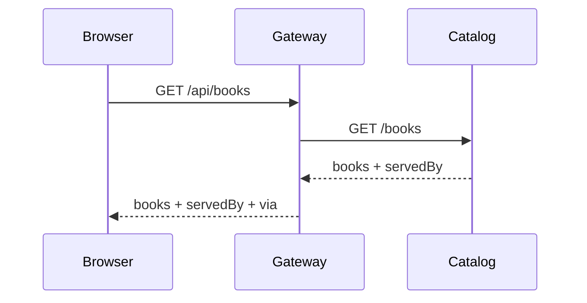

**Speaker notes**
Check the monolith has stopped. Pair anyone with a failed cold build rather than consuming the hour debugging downloads. Buy records a simulated order; do not imply payment. The internal wget runs inside the gateway container, where the service name resolves, not on the student's host browser.

**Lab connection**
Lab 2A:
```bash
docker compose up --build -d
docker compose ps
docker compose exec gateway wget -qO- http://catalog:3001/books
curl -i http://localhost:8080/api/books
```
Open port 8080, compare the catalog, and record the process that served the response. Compose is a one-line starter here, not a topic — Session 3 opens it up.

---

## Slide 15: Contracts And Ownership
**Time:** 3 min | **Mode:** Implemented lab

**Slide content**
- Actual public routes: books, order submission, recommendations.
- Services own behavior and data, not just URLs.
- Contract changes can couple otherwise separate deployments.

**Visual**
| Public request | Actual internal call | Classroom limitation |
|---|---|---|
| GET /api/books | GET catalog:3001/books | Fixed in-memory catalog |
| POST /api/orders | POST orders:3002/orders | Client-supplied title; volatile orders |
| GET /api/recommendations | GET recommendations:3003/recommendations | Static suggestions and failure switches |

**Speaker notes**
There is an internal GET /orders, but no public GET order-history route in this gateway. Do not teach the PDF's /products or /orders/{id} as runnable endpoints. Production would validate requests, use authoritative product/pricing data, define errors, and version contracts deliberately. Logical ownership can use separate schemas on a shared database server; sharing physical hardware is not sharing write ownership.

**Lab connection**
Ask which service should approve the submitted order data, and what happens if the browser supplies an invented title.

---

## Slide 16: Sync Or Async?
**Time:** 4 min | **Mode:** Conceptual extension

**Slide content**
- Need a result to continue? Request/response may fit.
- Announce a completed fact? An event may fit.
- Async moves waiting and failure management; it does not remove them.

**Visual**
| Operation | Candidate | New concern |
|---|---|---|
| Fetch books for this screen | HTTP request/response | Deadline and upstream errors |
| Request inventory reservation | Command, synchronous or asynchronous | Accepted versus completed status |
| Order confirmed; notify customer | Event plus consumer | Durability, duplicates, retry, lag |

**Speaker notes**
Command means "please do this"; event means "this happened." A command can also travel asynchronously. REST/HTTP is readable and used here; gRPC is another typed request/response option, not an automatic performance answer. Producer acknowledgment, consumer acknowledgment, and business completion are different milestones. "Fire and forget" alone is not a reliable-delivery design.

**Lab connection**
Pairs classify "ReserveInventory" and "OrderConfirmed", then state what the caller must know before telling the user checkout is complete.

---

## Slide 17: A Log Is Not A Message Broker
**Time:** 4 min | **Mode:** Conceptual extension

**Slide content**
- Implemented: orders logs an example `order.placed` event.
- Production extension: durable record plus eventual publication.
- Outbox addresses the write/publish gap; consumers deduplicate.

**Visual**
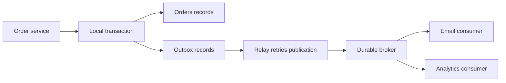

**Speaker notes**
Every box after the order service is conceptual here. The database does not spontaneously send a business event. The service writes its order and outbox record in one local transaction, then a relay publishes. A crash after publishing but before marking sent can produce a duplicate; at-least-once delivery still needs idempotent consumers. Kafka, RabbitMQ, and managed services offer different delivery models: select against requirements, not name recognition.

**Lab connection**
After Buy, inspect `docker compose logs orders`. Ask: "Where is the consumer? Where does this event survive a crash?" The correct answer is that neither exists in the starter.

---

## Slide 18: Scale The Bottleneck, Not The Diagram
**Time:** 4 min | **Mode:** Conceptual extension

**Slide content**
- Repeated reads: consider cache-aside; choose a freshness policy.
- Read pressure on a database: consider replicas; expect lag.
- Data/write growth beyond one node: consider partitioning.
- Measure before choosing any of them.

**Visual**
```text
Cache-aside: app checks cache -> hit returns
                          -> miss reads owned DB -> populates cache

Replica: more read capacity, but potentially stale reads
Shard: split data/write load, but complicate keys, joins, and rebalancing
```

**Speaker notes**
None of these stores runs in the current lab. A TTL bounds one source of staleness but is not a complete invalidation strategy. Name the term the revision bank uses: replica lag and copied data give **eventual consistency** — services may briefly disagree, then converge on the same answer. It is a deliberate decision per invariant, not a fixed duration. Discuss a stale book description versus stale inventory or payment status: the acceptable risk differs. SQL/NoSQL is a workload and correctness decision, not a microservices prerequisite. At our assumed peak of 46 requests/second, sharding is not justified without other evidence.

**Lab connection**
Student output: one cacheable bookstore result and one result they would not blindly serve from a stale cache.

---

## Slide 19: Break A Dependency, Observe The Decision
**Time:** 14 min | **Mode:** Implemented lab

**Slide content**
- Slow recommendations: bounded wait and reduced response.
- Stopped recommendations: orders still respond. That is **graceful degradation**.
- Stopped catalog: refresh and observe a failed catalog request.
- Without a deadline, waiting spreads: a **cascading failure**.
- Restore the environment before the break.

**Visual**
```text
Optional recommendations -> timeout -> 200 with degraded: true
Essential catalog       -> unreachable -> 503
Essential order call    -> unknown/failure -> never invent success

Cascade: slow dependency -> callers wait -> connections exhausted -> unrelated calls fail
```

**Speaker notes**
Allocate three minutes to prediction/slow mode, four to code and successful order, three to stopped-service contrast, and four to recovery/debrief. Recommendations polls every five seconds; catalog does not, so refresh after stopping/restoring it. Only recommendations has an application-defined deadline today. Essential calls need deadlines too; their failure policy differs. Say both terms aloud, because the quiz uses them: graceful degradation is losing a *feature* instead of the *system*; a cascading failure is one slow dependency consuming the caller's capacity until unrelated requests also fail. A slow dependency is often more dangerous than a dead one, because a failure returns instantly while slow calls accumulate. A timeout helps bound waiting, but does not by itself eliminate overload or every cascade. Circuit breakers, bulkheads, rate limits, and bounded retries complement it; they are not implemented here.

**Lab connection**
Lab 2B, with explicit refreshes:
```bash
docker compose exec recommendations wget -qO- http://localhost:3003/slow
curl -i http://localhost:8080/api/recommendations
docker compose stop recommendations
docker compose stop catalog
curl -i http://localhost:8080/api/books
docker compose start catalog recommendations
docker compose exec recommendations wget -qO- http://localhost:3003/ok
```
Click Buy while recommendations is slow/stopped. Refresh after catalog stops and after restoration. Inspect `docker compose logs gateway`.

---

## Slide 20: Timeout Does Not Mean Nothing Happened
**Time:** 4 min | **Mode:** Conceptual extension

**Slide content**
- An order may commit while its response is lost.
- A blind retry can duplicate a purchase.
- Use persisted idempotency keys and bounded retries.
- Backoff and jitter reduce synchronized retry storms.

**Visual**
```mermaid
sequenceDiagram
    participant Client
    participant Orders
    Client->>Orders: Checkout with key K
    Orders->>Orders: Persist result for K
    Note over Client,Orders: Response lost; client times out
    Client->>Orders: Retry with the same key K
    Orders-->>Client: Previously recorded result
```

**Speaker notes**
This sequence is not implemented in the lab. Store the key and result with concurrency-safe uniqueness, bind it to the request, and define expiry. An in-memory dictionary alone is not enough across restarts or replicas. Retry only errors that may be transient and operations made safe to repeat. Circuit breaker state and application cancellation do not prove the remote side cancelled a committed operation.

**Lab connection**
Ask whether two identical POSTs create one order or two in the current starter. Students should inspect the push into the array and explain why it creates two.

---

## Slide 21: Patterns Answer Problems
**Time:** 3 min | **Mode:** Design exercise

**Slide content**
- Many backend addresses -> gateway and discovery.
- Optional outage -> deadline and explicit fallback.
- Repeated failure -> circuit breaker; contended resources -> bulkhead.
- Duplicate intent -> idempotency, not more replicas.
- Durable event publication -> outbox and consumer deduplication.

**Visual**
```text
Problem -> Constraint -> Pattern -> Technology -> Evidence
```

**Speaker notes**
Use Quiz 2 questions 2 and 5 as the quick checkpoint. Define the two patterns students only heard in passing: a circuit breaker stops calling a repeatedly failing dependency for a period and fails immediately instead of waiting; a bulkhead isolates resources so one struggling dependency cannot consume them all. Neither is implemented in the starter. Retry belongs only on failures that may be transient, with a bound. Ask one student to explain why a catalog error has no fallback in this design; other businesses could deliberately offer a cached catalog. Avoid presenting the existing design choice as an intrinsic property of all catalogs. Verify the services are healthy before students leave.

**Lab connection**
Student output: select one pattern and state both the problem it solves and one cost it introduces.

---

## Slide 22: Break
**Time:** 10 min | **Mode:** Design exercise

**Slide content**
- Break: 11:20-11:30.
- Return to the same bookstore.

**Visual**
```text
Next: Dockerfile -> image -> container -> managed workload
```

**Speaker notes**
This is the only scheduled break and is inside Session 2's 60 minutes. Do not add a separate break after this hour. Use the pause to help pairs with failed setup; others need not perform a new exercise. If the college cannot permit a break here, retain these ten minutes as an in-room pause and catch-up buffer, not extra content.

**Lab connection**
No task. Leave the restored Compose application available for Session 3.

---

# Session 3: Containerization & Orchestration
**11:30-12:30. Package the application and understand its controllers.**

## Slide 23: From Code To A Repeatable Runtime
**Time:** 4 min | **Mode:** Conceptual extension

**Slide content**
- Code needs a runtime, files, configuration, and connectivity.
- An image packages repeatable application/runtime files.
- Configuration and secrets remain environment-specific.

**Visual**
```text
Application files + Node runtime -> image artifact
Image + configuration + available resources -> running container
```

**Speaker notes**
Students have already used Docker through Compose. Explain what it did rather than pretending this is their first encounter. Images reduce environment drift; they do not make all machines, CPU architectures, network paths, or secrets identical. Ask what needs rebuilding versus what can be supplied when starting a container.

**Lab connection**
Compare the copied source in the Dockerfile with URLs supplied through Compose environment variables.

---

## Slide 24: Containers Are Not Tiny VMs
**Time:** 4 min | **Mode:** Conceptual extension

**Slide content**
- VM: virtual hardware and a guest OS/kernel.
- Container: isolated processes sharing a host kernel.
- Isolation reduces some risks; it is not absolute security.

**Visual**
| VM stack | Container stack |
|---|---|
| App and libraries | App and libraries |
| Guest OS/kernel | Container isolation |
| Hypervisor | Shared host kernel |
| Host hardware | Host hardware |

**Speaker notes**
On Windows/macOS, Linux containers typically run using a Linux VM layer; inside the Codespace we use the provided Linux environment. Neither VM nor container chooses service boundaries for us. Kubernetes can orchestrate monoliths too. Avoid claiming every container holds a whole booted operating system.

**Lab connection**
Ask why a node image provides Node and userspace files but does not boot a separate Linux kernel per container.

---

## Slide 25: Recipe, Artifact, Instance
**Time:** 5 min | **Mode:** Implemented lab

**Slide content**
- Dockerfile describes a build.
- Image is the artifact; container is an instance.
- One image can start many containers.
- Tags are convenient names; digests identify immutable content.

**Visual**
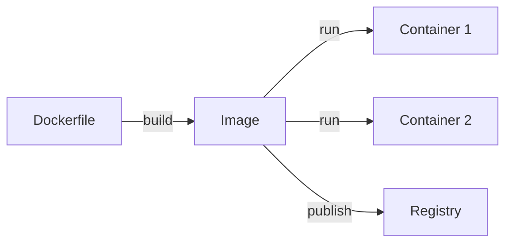

**Speaker notes**
Changing source does not change a built image. Rebuild, make the artifact available, then update the workload. An image's content is immutable, but a tag such as v1 can be repointed; production needs an artifact-identification policy. The workshop transfers images locally with minikube, so a Docker Hub account is unnecessary.

**Lab connection**
Run `docker images` and identify the four `bookstore-*:v1` artifacts built by Compose.

---

## Slide 26: Build And Inspect Catalog
**Time:** 10 min | **Mode:** Implemented lab

**Slide content**
- FROM: Node runtime base.
- COPY: source included at build time.
- EXPOSE: port documentation, not host publication.
- CMD: command executed when the container starts.

**Visual**
```dockerfile
FROM node:22-alpine
WORKDIR /app
COPY server.js ./
EXPOSE 3001
CMD ["node", "server.js"]
```

**Speaker notes**
Read the actual five instructions, then let them build and run a container by hand — this is the first Docker command they type all day, so protect the time. The rebuild is cached, which makes the layer model concrete. `catalog-solo` lands on a different network under a different name, so the gateway does not use it: that is the point, not a bug. Dockerfiles currently do not switch to a non-root user; discuss hardening later without silently changing the demo.

**Lab connection**
Lab 3A:
```bash
docker build -t bookstore-catalog:v1 ./catalog
docker run -d --name catalog-solo -p 3001:3001 bookstore-catalog:v1
docker ps
docker rm -f catalog-solo
```
Success: a cached rebuild, two containers from one image, raw catalog JSON on published port 3001, and a clean `docker ps` afterwards.

---

## Slide 27: Which Port Is Where?
**Time:** 4 min | **Mode:** Implemented lab

**Slide content**
- App listens inside a container on its service port.
- Compose publishes only gateway port 8080 to the host.
- localhost means the environment where the command runs.
- Codespaces forwards a host port to your browser.

**Visual**
```text
Laptop browser -> Codespaces forwarded URL -> host :8080
               -> gateway container :8080 -> catalog container :3001
```

**Speaker notes**
The host terminal's localhost and an exec command's localhost are different places. On the laptop, localhost does not mean the Codespace. Internal services are reachable on the container network; no published host port is not authorization. A Kubernetes Service adds another routing abstraction, not another application business service.

**Lab connection**
Students explain why the `wget` ran inside the gateway container, and why the Ports tab offered 3001 only once they published it with `-p`.

---

## Slide 28: Restart Policy Versus Workload Reconciliation
**Time:** 10 min | **Mode:** Implemented lab

**Slide content**
- This Compose file has no restart policy.
- Docker can restart configured containers; policy matters.
- Kubernetes controllers maintain declared workload replicas.
- Shut down Compose before starting minikube.

**Visual**
| Observed event | Meaning |
|---|---|
| Catalog container exits here | No configured restart; inspect its exited state |
| Container crashes in a Pod | Kubelet may restart it within that Pod |
| Managed Pod is deleted | Controller creates a replacement Pod |

**Speaker notes**
Use `ps -a` so students see the stopped container rather than think it vanished. Do not generalize a manual kill to all application-crash tests. Name **orchestration** here: running containers across machines and keeping them in the state you declared. Compose is not an orchestrator in that sense — it runs containers on one machine and will not maintain a declared number of healthy copies, which is exactly what the quiz asks. Allow ten minutes including minikube startup; begin at about 11:57 and explain the following objects while it boots. The local one-node cluster does not demonstrate survival of a whole-machine outage.

**Lab connection**
Lab 3B. From `docker compose ps`, choose one catalog container ID and replace `CATALOG_CONTAINER_ID` below:
```bash
docker kill CATALOG_CONTAINER_ID
docker compose ps -a
docker compose down
minikube start --driver=docker
kubectl get nodes
```
The node must become Ready before Session 4. If unavailable, use the instructor cluster, not an unbounded class-wide troubleshooting session.

---

## Slide 29: Who Keeps The Pods Alive?
**Time:** 6 min | **Mode:** Conceptual extension

**Slide content**
- Pod: a scheduling unit with one or more containers.
- Deployment manages rollout revisions through ReplicaSets.
- ReplicaSet maintains the required Pod count.
- Kubelet runs/restarts containers on its node.

**Visual**
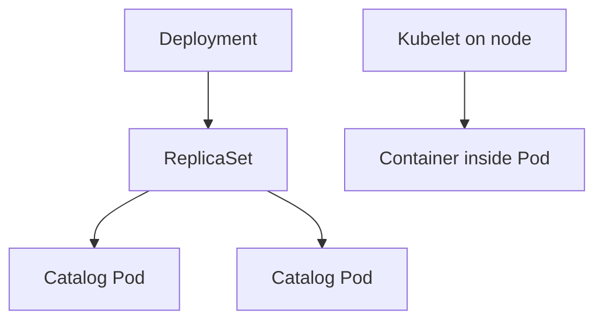

**Speaker notes**
One container per Pod is a lab simplification, not the definition of Pod. Desired state reconciliation acts when the infrastructure can satisfy it; absent capacity, images, or healthy code cannot be wished away. A Service does not create Pods. At workshop level "Deployment replaced it" is acceptable shorthand; explain the ReplicaSet's immediate responsibility.

**Lab connection**
Lab 3C: find catalog's replicas, Pod-template labels, container image, and matching selector in [bookstore.yaml](../lab-starter/k8s/bookstore.yaml).

---

## Slide 30: A Service Is A Stable Routing Abstraction
**Time:** 5 min | **Mode:** Conceptual extension

**Slide content**
- Pod addresses change; the Service name remains.
- Selectors identify the intended endpoints.
- Clients call a Service address, not a particular Pod.
- Controllers are not application request-path hops.

**Visual**
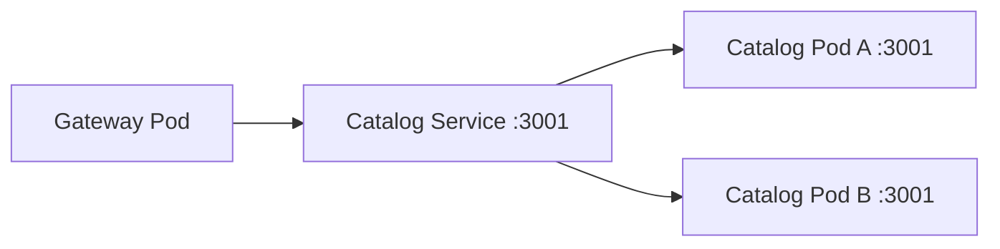

**Speaker notes**
DNS for a normal ClusterIP Service resolves to its Service address, not a rotating list of Pod addresses. Service routing reaches its eligible endpoints. A Deployment or Kubernetes control plane is not a box through which every HTTP request passes. The lab's gateway is exposed as NodePort, but we will reach it by port-forward on minikube.

**Lab connection**
Match the catalog Service selector to the Deployment's Pod labels. Explain why the existing `CATALOG_URL` works on both platforms.

---

## Slide 31: Running Is Not Ready
**Time:** 4 min | **Mode:** Conceptual extension

**Slide content**
- Startup probe: allow initialization before other probes.
- Readiness probe: should this Pod receive Service traffic?
- Liveness probe: should this container be restarted?
- These probes are not configured in the starter manifest.

**Visual**
```text
Process running -> application initialized -> eligible for requests
                 not all the same signal
```

**Speaker notes**
The existing /health handler simply returns OK; it is not a configured readiness probe or proof every dependency works. A readiness failure normally removes a Pod from Service traffic without restarting it. A liveness failure can restart a container, so tying liveness to every remote dependency can create restart storms. Refer to the official [probe guide](https://kubernetes.io/docs/tasks/configure-pod-container/configure-liveness-readiness-startup-probes/) for follow-up.

**Lab connection**
Find /health in catalog code, then confirm there is no readinessProbe field in the manifest. Name the missing wiring.

---

## Slide 32: Configuration And Change Safety
**Time:** 5 min | **Mode:** Conceptual extension

**Slide content**
- Configuration outside the image; secrets handled separately.
- Rolling update: gradually replace instances.
- Canary: route a limited share to a new version and observe.
- Blue/green: switch between prepared environments.

**Visual**
| Change | Required safeguard |
|---|---|
| Rolling replacement | Readiness, spare capacity, connection draining |
| API/schema change | Old/new compatibility during overlap |
| Rollback | Known artifact and compatible stored data |

**Speaker notes**
Only a basic rolling Deployment is used here; canary and blue/green are comparisons. ConfigMaps and Secrets are platform tools, not magically secure business logic. Environment variables alone do not prevent leaks. A rollback changes the Pod template; it does not revert orders or database migrations. Kubernetes cannot substitute for backup, authorization, or safe data design.

**Lab connection**
Locate gateway environment configuration in the manifest. Students name one condition a real zero-downtime rollout would need beyond default Deployment behavior.

---

## Slide 33: Platform Versus Application
**Time:** 3 min | **Mode:** Design exercise

**Slide content**
- Platform: schedule, route, restart, replace, scale, roll out.
- Application: correctness, ownership, durable data, safe retries.
- More Pods cannot recover an order stored only in memory.

**Visual**
```text
Kubernetes repairs workload state.
Application design preserves business state and invariants.
```

**Speaker notes**
Use Quiz 3 questions 2 and 5 for the quick check. Confirm minikube node Ready before continuing. If it is not, use the planned instructor route. Ask what happens to orders when its container restarts: the correct answer is lost volatile state, even if the workload comes back.

**Lab connection**
Student output: identify one platform guarantee and one business guarantee that the starter does not provide.

---

# Session 4: Hands-on & Industry Insights
**12:30-13:30. Deploy, observe, and defend the remaining design work.**

## Slide 34: Deploy The Existing Images
**Time:** 10 min | **Mode:** Implemented lab

**Slide content**
- Build artifacts exist in host Docker, not necessarily in minikube.
- Load all four images before applying the manifest.
- Check rollout state and an actual application response.

**Visual**
```text
Host Docker images -> minikube image store
Manifest -> Deployments/Services -> running application
```

**Speaker notes**
Lab 4A assumes Compose built the images and minikube is Ready. imagePullPolicy Never is a local-lab choice, not a universal production setting. If an image is missing, inspect the exact tag rather than repeatedly applying YAML. Do not treat Running alone as user-facing success. Instructor fallback covers students whose cloud environment cannot run a cluster within this budget.

**Lab connection**
```bash
minikube image load bookstore-gateway:v1
minikube image load bookstore-catalog:v1
minikube image load bookstore-orders:v1
minikube image load bookstore-recommendations:v1
kubectl apply -f k8s/bookstore.yaml
kubectl rollout status deployment/catalog --timeout=120s
kubectl rollout status deployment/orders --timeout=120s
kubectl rollout status deployment/recommendations --timeout=120s
kubectl rollout status deployment/gateway --timeout=120s
kubectl get pods
kubectl port-forward service/gateway 8080:8080
```
Keep port-forward in this terminal. In a second terminal, use `curl -i http://localhost:8080/api/books` and open forwarded port 8080. Long readiness failures are a switch-to-demo signal, not permission to exceed the ten minutes.

---

## Slide 35: Delete A Managed Pod
**Time:** 6 min | **Mode:** Implemented lab

**Slide content**
- Predict: who replaces a deleted catalog Pod?
- **Desired state**: you declare replicas; the platform repairs the difference.
- Automatic replacement is **self-healing** — a new identity, not a resurrection.
- Recovery takes time and needs available resources.

**Visual**
```text
Desired catalog Pods: 1
Delete existing Pod -> actual count below desired -> replacement Pod
```

**Speaker notes**
Lab 4B. Both quiz answers come from this slide: the **Deployment** is what replaced the Pod, because the Pod is the thing that was deleted and cannot resurrect itself; desired state means you declare *what* you want and the platform continuously repairs reality to match, which is why self-healing is automatic rather than scripted. At one replica, there can be an availability gap. Do not call that "no downtime." The Deployment's ReplicaSet maintains count; the kubelet starts the scheduled replacement container. We delete catalog, not orders, to avoid confusing process recovery with persistence. Keep gateway port-forward alive; deleting its backing Pod can require restarting that forwarding command.

**Lab connection**
In the second terminal:
```bash
kubectl get pods -l app=catalog
kubectl delete pod CATALOG_POD_NAME
kubectl get pods -l app=catalog -w
```
Replace `CATALOG_POD_NAME` with the listed name. Stop the watch with Ctrl+C after observing the replacement and check the catalog response again.

---

## Slide 36: Give Capacity To One Capability
**Time:** 6 min | **Mode:** Implemented lab

**Slide content**
- Scale catalog, leave orders at one replica.
- Inspect desired, ready, and available replicas.
- This demonstrates independent capacity allocation, not 5x throughput.

**Visual**
```text
catalog: 1 -> 5 replicas
orders: 1
recommendations: 1
gateway: 1
```

**Speaker notes**
Lab 4C. The catalog is a fixed read-only list, so multiple copies can answer the same way. Five Pods do not prove five times the throughput; the gateway, CPU budget, network, or data layer may limit gains. Minikube is one node, so this does not demonstrate multi-node high availability. Do not scale the volatile order array and imply production correctness.

**Lab connection**
```bash
kubectl scale deployment catalog --replicas=5
kubectl rollout status deployment/catalog --timeout=120s
kubectl get deployments
kubectl scale deployment catalog --replicas=4
```
Success: independent replica counts. Reduce further if the rehearsal shows insufficient room for the next rollout's surge.

---

## Slide 37: Roll Forward, Then Roll Back
**Time:** 8 min | **Mode:** Instructor demo

**Slide content**
- Change a catalog title and build v2.
- Load the new artifact; update the Pod template.
- Observe gradual replacement and user responses.
- Rollback is another rollout, not a time machine.

**Visual**
```text
v1 v1 v1 v1 -> v1 v1 v1 v2 -> ... -> v2 v2 v2 v2
Rollback: deploy earlier Pod template; business data is not rewound
```

**Speaker notes**
Lab 4D is an instructor demonstration in this draft, not twelve minutes of work for every pair. Rehearse and keep a prepared v2 artifact as backup. Inspect requests during replacement rather than declare zero downtime from rollout status alone. No readiness probes or load test are added by this script. A new Deployment revision does not necessarily mean the release is business-correct.

**Lab connection**
After changing a title in catalog source:
```bash
docker build -t bookstore-catalog:v2 ./catalog
minikube image load bookstore-catalog:v2
kubectl set image deployment/catalog catalog=bookstore-catalog:v2
kubectl rollout status deployment/catalog --timeout=120s
curl -i http://localhost:8080/api/books
kubectl rollout undo deployment/catalog
kubectl rollout status deployment/catalog --timeout=120s
curl -i http://localhost:8080/api/books
```
Refresh the browser to see each version. Students can repeat the full existing lab after class.

---

## Slide 38: Observe The User Journey
**Time:** 5 min | **Mode:** Implemented lab

**Slide content**
- Logs: what happened at a particular service.
- Metrics: rate, errors, duration, saturation, queue lag.
- Traces: where one request spent time across services.
- The starter provides console logs, not a full observability stack.

**Visual**
```text
User request -> gateway -> orders
Logs: service events
Metrics: aggregate behavior over time
Trace: related spans for this request
```

**Speaker notes**
Generate a simulated order through the browser, then inspect the order log. The event label is not delivery confirmation. Request/correlation IDs and OpenTelemetry would be extensions; the starter does not propagate traces. A CPU graph alone does not show successful checkout. A conceptual alert should track user-facing latency/errors with a defined window, not page someone for each optional recommendation fallback.

**Lab connection**
```bash
kubectl logs deployment/orders --tail=20
kubectl logs deployment/gateway --tail=20
```
Student output: state what these logs prove, and one question they cannot answer without extra instrumentation.

---

## Slide 39: Security Is More Than A Private Port
**Time:** 4 min | **Mode:** Conceptual extension

**Slide content**
- Authentication: who are you? Authorization: may you do this?
- Validate requests; enforce least privilege at trust boundaries.
- Keep secrets out of source, images, browser code, and logs.
- Run with minimal privileges and scan artifacts.

**Visual**
| Starter gap | Production control |
|---|---|
| No identity or authorization | Authenticate and check permissions |
| Client-supplied order fields | Validate against authoritative rules/data |
| No non-root Dockerfile user | Restrict container identity and permissions |
| No network policy | Restrict allowed flows and credentials |

**Speaker notes**
Do not describe the classroom app as hardened. A gateway can check identity, but services still need appropriate authorization and must not blindly trust internal calls. Kubernetes Secrets are not automatically a complete secret-management solution; access control and encryption configuration matter. If a credential is exposed, revoke/rotate it rather than merely remove it from the current file.

**Lab connection**
Students inspect the order request and name one input they should not trust. No real secret or payment credential is used during the workshop.

---

## Slide 40: Checkout Needs Business Recovery
**Time:** 4 min | **Mode:** Conceptual extension

**Slide content**
- Persist a pending order; reserve inventory; attempt payment.
- A timeout leaves payment outcome unknown.
- Reconcile before deciding to retry or compensate.
- Saga compensation is a business action, not ACID rollback.

**Visual**
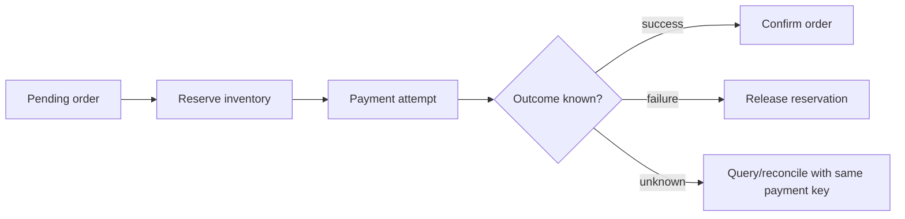

**Speaker notes**
Every box is a conceptual addition. Inventory and payment are not implemented in the starter. Reconciliation eventually feeds a success/failure decision; it must not silently treat unknown as failure. Compensation can fail and needs its own retries and tracking. A payment already captured might require a refund, which has real business consequences. Email notification can follow confirmed status asynchronously.

**Lab connection**
Ask: "The user times out, but the payment provider captured money. Which record lets us decide safely what happens next?"

---

## Slide 41: Release A Known Artifact
**Time:** 3 min | **Mode:** Conceptual extension

**Slide content**
- Test contracts and business rules before deployment.
- Build, scan, publish, and deploy an identified artifact.
- Verify user-facing behavior; promote or roll back deliberately.

**Visual**
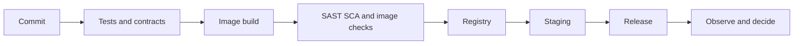

**Speaker notes**
This is a pipeline discussion, not an existing CI/CD workflow for the starter. SAST checks source, SCA checks dependencies, and image scans inspect packaged components; none proves business correctness. Continuous delivery keeps a releasable artifact with a release decision; continuous deployment automates that decision after checks. Retain rollback artifacts and compatible contracts, not only the latest mutable tag.

**Lab connection**
Map the manual v2 demo to build, distribute, deploy, verify, and rollback. Identify which steps would need tests or policy gates before automation.

---

## Slide 42: Industry Case: Reduce Dependency Complexity
**Time:** 3 min | **Mode:** Conceptual extension

**Slide content**
- Uber described roughly 2,200 services and rising coordination costs.
- DOMA groups services into domains with explicit interfaces and layers.
- The lesson: meaningful boundaries, not maximum service count.

**Visual**
```text
Before: consumers depend on many implementation details
After: consumer -> domain interface -> related internal services
```

**Speaker notes**
Source: Uber's 23 July 2020 [DOMA article](https://www.uber.com/blog/microservice-architecture/). It describes categorising services into domains, not simply rewriting them into a few large services or returning to one monolith. Ask how the same principle applies to catalog and reviews: can we reduce what callers must know? Historical examples explain pressures and trade-offs; they are not universal templates.

**Lab connection**
Students propose one dependency they would hide behind a stable interface in their assignment and one disadvantage of doing so.

---

## Slide 43: Defend A Checkout Extension
**Time:** 8 min | **Mode:** Design exercise

**Slide content**
- Extend this bookstore: inventory, payment, eventual notification.
- Label data owners and sync/async paths.
- Mark one bottleneck and one unknown-outcome recovery path.
- A justified modular monolith remains a valid choice.

**Visual**
```text
Requirements -> Assumptions -> Diagram -> Failure case -> Trade-off
```

**Speaker notes**
Three minutes to draw, two to label ownership and communication, two for two pairs to defend a decision, one for feedback. Score requirements, boundaries, communication, failure correctness, and trade-off reasoning, each 0-2. Do not require every production component from earlier diagrams. Ask "Why this component?" and "What did it make harder?" rather than count technologies. This is a design exercise, not an eight-minute payment implementation.

**Lab connection**
Student output: one diagram and a 30-second explanation. A complete answer includes idempotency/reconciliation when retrying a payment with unknown outcome.

---

## Slide 44: Design, Demonstrate, Explain
**Time:** 3 min | **Mode:** Design exercise

**Slide content**
- Requirements -> estimate -> simple design -> bottlenecks.
- Boundaries -> communication -> failure -> secure operation.
- Exit question: what did Kubernetes not solve for our orders?
- Next: the existing reviews-service assignment plus design reasoning.

**Visual**
```text
We ran: monolith, services, fallback, containers, replacement, scaling.
We discussed: durability, messaging, idempotency, probes, security, CI/CD.
We did not prove: production-safe checkout or zero-downtime service.
```

**Speaker notes**
Take one exit response: restarting orders restores the process, not its lost array. Assign Quiz 4 and the revision bank in `Workshop-Guide.md` afterwards. The assignment budgets 4-5 hours. Clean up resources and stop Codespaces so usage does not continue. Close by asking for one defended decision, not a slogan about microservices.

**Lab connection**
Read [Assignment.md](../Assignment.md). For the proposed revision, add a short requirements/estimate/failure-policy paragraph to its DESIGN.md, after agreement on the assignment update. Stop port-forward with Ctrl+C, then:
```bash
kubectl delete -f k8s/bookstore.yaml
minikube stop
```
Stop the Codespace through its management menu.

---

# Appendix: Optional Transfer And Depth
**Not included in the 240-minute live schedule.**

## Appendix A1: URL Shortener, From Requirements
**Mode:** Optional interview transfer

**Slide content**
- Create a short link; redirect it; decide expiry and custom aliases.
- Establish read/write ratio and latency target.
- Begin with an API and a mapping store, not sharding.

**Visual**
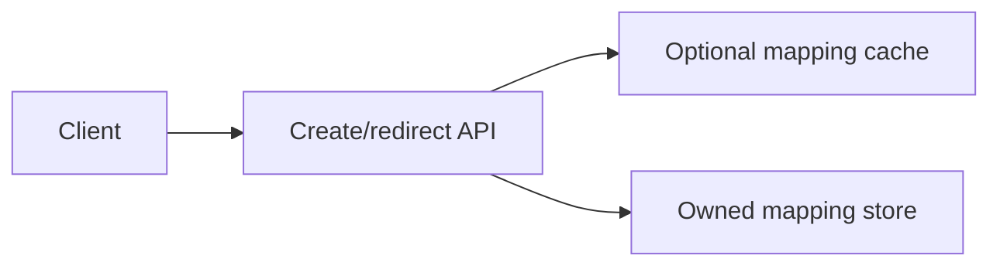

**Speaker notes**
Ask whether links may expire and whether destinations can change. Specify rate limits and abuse controls. Caching immutable mappings is simpler than rapidly changing ones. Base62 is an encoding, not a uniqueness guarantee or a security control. No URL-shortener code is included here.

**Lab connection**
Student output: two endpoint contracts, a sample mapping record, and an estimate with stated assumptions.

---

## Appendix A2: IDs, Hot Keys, And Partitioning
**Mode:** Optional interview transfer

**Slide content**
- Unique IDs need a generation/coordination strategy.
- Random codes need collision handling.
- A viral link can be one hot key even after sharding.
- Add caching/replicas only with a clear workload goal.

**Visual**
```text
Uniform keys -> evenly distributed shards, if the partitioner fits
One viral key -> one concentrated hotspot; partition count alone may not help
```

**Speaker notes**
Sequential IDs can be easy to generate but expose volume and need coordinated generation across writers. Random IDs need sufficient space and a uniqueness constraint/retry. Replicas may serve stale mappings; define whether staleness is acceptable after deletion. Discuss what consistent hashing helps with, and what it does not solve, rather than require its implementation.

**Lab connection**
Ask students to identify why `orders.length + 1` is not a globally unique ID strategy across replicas.

---

## Appendix A3: News Feed And Fan-Out
**Mode:** Optional interview transfer

**Slide content**
- Fan-out on write: prepare followers' feeds when publishing.
- Fan-out on read: assemble when a follower opens the feed.
- Hybrid: treat high-follower accounts differently.

**Visual**
| Strategy | Helps | Costs |
|---|---|---|
| On write | Fast reads | Many writes; work for inactive users |
| On read | Less precomputation | More work and latency at read time |
| Hybrid | Handle skew | Multiple paths and merge complexity |

**Speaker notes**
State follower counts and active-user ratios before choosing. Queue lag affects when new posts appear; idempotent fan-out prevents duplicates on retry. This is an original trade-off exercise, not a reproduction of a book chapter or an implementation of a social network.

**Lab connection**
Pairs compare a class of 100 followers with a celebrity account of 10 million. Justify a policy for each.

---

## Appendix A4: Event Delivery And Recovery
**Mode:** Conceptual extension

**Slide content**
- Persist intent with an outbox; retry publication.
- Deduplicate processing with an event ID and durable progress.
- Bound retries; handle poison messages and dead letters.
- Monitor lag and reconcile incomplete workflows.

**Visual**
```text
Order + outbox transaction -> relay -> broker -> consumer
                                  possible duplicates
Consumer: apply business change + record processed event atomically
```

**Speaker notes**
At-least-once delivery can redeliver. A dead-letter queue is an investigation/recovery mechanism, not deletion of the business problem. Ordering guarantees often apply per key/partition, not globally. Replaying messages must not replay unintended payments. "Exactly once" claims depend on scope and do not automatically cover external side effects.

**Lab connection**
Students identify crash windows before publication and after delivery. Contrast both with the starter's console log.

---

## Appendix A5: Availability, Consistency, And Cost
**Mode:** Optional interview transfer

**Slide content**
- Availability: can users complete the operation?
- Durability: does committed data survive failure?
- Consistency: which invariants and read guarantees matter?
- Replicas, regions, and coordination have costs.

**Visual**
| Decision | Benefit | Trade-off |
|---|---|---|
| Read replica | Read capacity | Replication lag |
| Synchronous replication | Stronger acknowledgment guarantees | Latency and unavailable-peer behavior |
| Cache | Lower read latency | Staleness and invalidation |
| Multiple regions | Geographic resilience/latency | Cost and cross-region coordination |

**Speaker notes**
CAP concerns behavior during a network partition; it is not a general command to "pick any two" in every situation. State an operation's consistency needs before selecting a datastore. Eventual consistency requires convergence conditions, not a universal duration. Discuss a stale recommendation separately from a double payment.

**Lab connection**
Ask whether a 201 returned by the in-memory orders service is proof that an order survives a process crash. It is not.

---

## Appendix A6: Interview Walkthrough And Further Reading
**Mode:** Optional interview transfer

**Slide content**
- Clarify scope, users, workload, targets, and non-goals.
- Define APIs/data; draw a simple design.
- Identify bottlenecks, failures, and safeguards.
- Justify one trade-off and explain an alternative.

**Visual**
```text
Problem -> Clarification -> Estimate -> APIs/data -> Architecture
        -> Deep dive -> Failure/operations -> Trade-offs -> Recap
```

**Speaker notes**
For practice, use an eight-minute explanation: one minute clarification, one estimation, two APIs/diagram, two scaling/failure, one security/observability, one trade-off recap. This is a practice format, not a promised interview rubric. Refer to Alex Xu for further interview examples and Sam Newman for service design; do not equate their books with one mandatory architecture.

**Lab connection**
Reuse the bookstore sketch. Further reading: [MonolithFirst](https://martinfowler.com/bliki/MonolithFirst.html), [microservices patterns](https://microservices.io/patterns/), [Docker restart policies](https://docs.docker.com/engine/containers/start-containers-automatically/), [Kubernetes Deployments](https://kubernetes.io/docs/concepts/workloads/controllers/deployment/), and [Uber DOMA](https://www.uber.com/blog/microservice-architecture/).